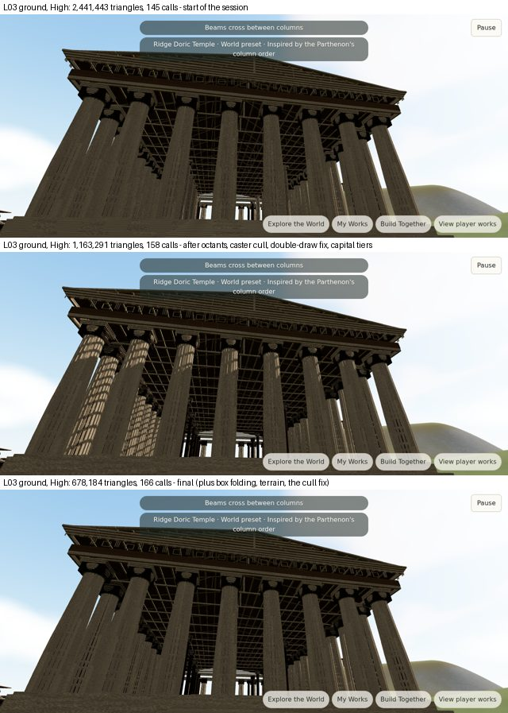
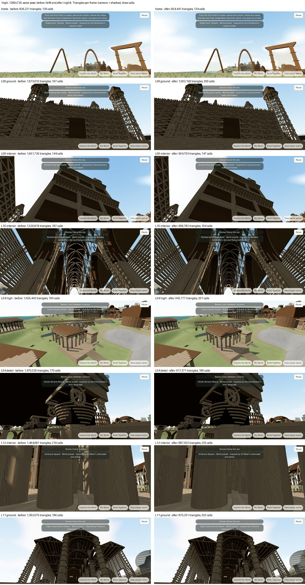

# Triangles and draw calls per frame (brief §10, Appendix C3)

The brief's per-frame targets: High ≤ 250 draw calls and ≤ 1.2 M triangles, Medium ≤ 150 and ≤ 600k, Low ≤ 90 and
≤ 250k. It calls them initial targets, and they apply to the current frame wherever the explorer is, so they were
measured at **every authored viewpoint**, not just the home view.

## How it was measured

`WorldView.triangleBreakdown()` (test flag only) renders one extra frame with per-object accounting: `onAfterRender`
for the camera pass and `onAfterShadow` for the shadow-map pass, with the same per-frame shadow-caster culling as the
real frame. Its sums match `renderer.info.render.triangles`. Each run is one supervised `tour.ts --stage tris` at
1280 × 720: the settled home view, then every landmark's ground, interior, detail and high viewpoints (80 views), then
home again. That's 82 frames per tier, each waiting for the landmark's detail (near views) or for streaming to settle.

Everything ran on headless Chromium with SwiftShader. Triangle and draw-call counts don't depend on the GPU; frame
rate does, and it was **not measured** (see [requirements-status.md](requirements-status.md) for the manual steps).

## Result

| Tier | Views over the triangle target (before → after) | Median | Largest | Views over the draw-call target | Largest |
| --- | --- | ---: | ---: | --- | ---: |
| High | 16 of 82 → **0** | 924k → 621k | 1,673,610 → **1,002,158** (L09 ground) | 0 → 0 | 225 (L12 interior) |
| Medium | 64 of 82 → **18** | 781k → 501k | 1,493,303 → 812,545 (L09 ground) | 14 → 18 | 196 (L19 detail) |
| Low | 73 of 82 → **43** | 382k → 257k | 786,320 → 449,158 (L04 detail) | 36 → 37 | 145 (L09 ground) |

"Before" is the first 82-view run ([High](triangles/5-high-before.json), [Medium](triangles/5-medium-before.json),
[Low](triangles/5-low-before.json)); "after" is the final build ([High](triangles/6-high-final.json),
[Medium](triangles/6-medium-final.json), [Low](triangles/6-low-final.json)). Per view: triangles, calls, camera and
shadow pass, by category. The 82-view "before" was taken partway through the work: the changes in the next section
had already brought the Doric entrance from 2.44 M to 1.16 M.

**High meets both targets at every view.** Medium and Low don't; what remains is below.

## The Doric entrance (L03 ground): 2.44 M → 678k

At the start of the session, L03's ground viewpoint drew 2,441,443 triangles at High
([data](triangles/0-high-session-start.json), 20 views of six dense landmarks). By component and pass (k = thousand,
camera / shadow):

| Step | Triangles | Calls | Where the saving came from |
| --- | ---: | ---: | --- |
| Start | 2,441,443 | 145 | `detail:D` 1,226k / 0 (the 46 fluted columns' D pieces), `detail:M` 260k / 190k, far chains 117k / 160k, near chains 139k |
| D pieces in 20 m octants | 1,556,235 | 171 | A 40 m cell enclosing the camera put everything in it at full detail, including flutes 50 m away. Each cell's D pieces now sit in eight octant runs with their own level (`decode.ts` `dOct`, `WorldView.setOctantLevel`). `detail:D` 1,226k → 371k. Test: `world-memory.test.ts` "groups each cell's D pieces into octant runs" |
| Shadow-caster culling | 1,464,411 | 161 | Casters whose light-space footprint misses the visible part of the shadow map skip the shadow pass for the frame (`WorldView.cullShadowCasters`). Far-chain shadows 160k → 112k. *This step had a bug, below* |
| No far-mesh double draw | 1,368,411 | 159 | A landmark whose detail arrived while it was already at the near level kept drawing its far mesh too. Far 117k / 112k → 69k / 64k. Test: `world-keyboard.spec.ts` "drawn by its cells only (no far-mesh double draw)" (it failed before the fix) |
| Doric capital tiers | 1,163,291 | 158 | The capital's upper rings and inner ring moved into the near-detail tier (`orders.ts`); the structural tier keeps its outline. `detail:D` 371k → 221k, near chains 109k → 54k |
| Box folding, per-chunk terrain, the cull fix | **678,184** | 166 | Below. `detail:D` 221k → 110k, `detail:M` 260k / 190k → 130k / 95k |

Same pose and frame. The final frame (bottom) matches the starting one (top): the same columns, flutes, capitals,
ceiling grid and the cella behind, with the same shading. A pixel diff found 1.3 % of pixels changing by more than
24/255, mostly in the grass and fine flute lines. The middle frame shows the shadow-culling bug: light stripes on the
left-hand columns.

## What changed in the 82-view pass

1. **Box folding** (`materials.ts` `FOLD`; `WorldView.ts` `foldedBox`, `chainSleeve`). A closed box shows at most
   three faces to an eye, and a front-sided material's shadow pass draws at most three, the ones facing away from
   the light. Every stick is now three faces of its box (6 triangles, not 12), and every merged chain two (4, not 8).
   The vertex shader turns each face 180° about a perpendicular axis onto its opposite face whenever that's the one
   the pass would draw: toward the eye in the camera pass, away from the sun in the shadow pass. The faces drawn,
   their normals and shading coordinates are exactly the full box's, so the image is the same and half the
   triangles are submitted. This halved `detail:M`, `detail:D`, `far` and the chain cells in both passes. Nothing is
   hidden. `world-geometry.test.ts` checks the kept faces and that the fold keeps winding.
2. **Terrain detail per 128 m chunk instead of per 512 m tile** (`WorldView.updateTile`, `environment.ts`
   `tileGeometry`). Before, a whole tile of 16 chunks took the step of its nearest corner. Now each chunk takes its
   own, from its own distance. Coarser is allowed only where the step's geometric error, projected at that distance,
   stays under 1.5 / 2 / 3 drawing-buffer pixels (High / Medium / Low), never coarser than the old tile rule gave the
   chunk. Cliffs keep their detail; smooth meadows go coarse. Skirts close the edges where steps differ
   (`world-geometry.test.ts`). The first version, distance only, put coarse green bands on L14's cliffs; the error
   bound came from that side-by-side.
3. **A jump now refreshes terrain and grass at the destination** (`WorldView.jumpTo`). A teleport had left the
   departure point's terrain detail and grass in place until the explorer walked 6 m. That is why the same pose
   showed different ground in "home" and "home again". It's a correctness fix, and it changed some screenshots: L17's
   cliff now shows rock detail where the old frame had stale coarse ground. `world-keyboard.spec.ts` "after a jump
   the terrain's detail follows" failed without it.
4. **Shell cylinders by tier**: 20 / 16 / 12 radial segments at High / Medium / Low.
5. **The shadow-culling fix** (`shadow-cull.ts`). The cull tested each caster's *geometry* bounding sphere. For the
   shading shells, which are `InstancedMesh`es of a unit box or cylinder, that is a 1 m sphere at the world origin, so
   every shell was culled from the shadow pass everywhere. Inside colonnades and under roofs the shells are what cast
   the shade; without it, sunlight lit the columns and floors (the middle frame above; also L04's portico and L15's
   floor). Found in the same-pose sequence above, not by a test. The cull now uses the mesh's own instance bounds.
   `world-shadow-cull.test.ts` fails on the old logic. The fix costs triangles: shell shadows are back, so the High
   median rose from 607k to 621k and Medium went from 14 to 18 views over 600k and from 14 to 18 over 150 calls.
   Low has no shadows and didn't change.

The home view and the seven heaviest High views of the 82-view "before" run, at the same pose and frame, before
(left) and after (right). The "before" frames already had the shadow-culling bug; the "after" frames have the fix.

## What was tried and taken out

- **Shells grouped per region at Low** (no shadows there, so per-landmark culling buys less): 7 fewer views over 90
  calls, but shells rose from a mean of 40k to 65k triangles and 9 more views went over 250k. Reverted.
- **A view-fitted shadow box**: measured no better than the fixed box at L03 (1,559,295 against 1,556,235). Reverted.

## What remains, and what closing it would cost

**Medium triangles (18 views over 600k).** All are near-detail views of dense landmarks: L09 ground 813k, L09
interior 794k, L10 interior 770k, L04 detail 760k, L04 high 700k, then 13 between 690k and 605k. At L09 ground,
`detail:M` is 367k of the 813k, shells 91k and far chains 133k. Medium already uses smaller full-detail and structural
radii (40 m and 90 m) than High. Meeting 600k there means a lower piece density near the camera, a visible loss of
the close-up framing the brief also asks for, so it was not done blindly. The far chains are at the top of the brief's
mid guidance (6,000 members); 4,000 would save about 8k per mid-level building.

**Low triangles (43 views over 250k).** Median 257k. The fixed costs that don't scale with the near landmark are
already most of the budget at the home view (308k): shells 103k, far chains 72k, terrain 63k, rocks 49k.

**Draw calls at Medium (18 over 150) and Low (37 over 90).** At Low's home view, 120 calls: shells 40 (one mesh per
landmark × shape × finish), terrain 23, far meshes 18, portals 9, rocks 8. At L09 ground, 145: 37 of them are the
near landmark's chain cells (one mesh per 40 m cell). Both need structural merging that wasn't built:

- one chain mesh per landmark instead of one per cell (halves the Low views over 90, by count from the measured
  breakdown);
- a shell grouping that keeps per-landmark culling, e.g. shells merged into the far mesh's draw.

**Rocks** (110k at High) are baked per island grid cell without a level of detail.
